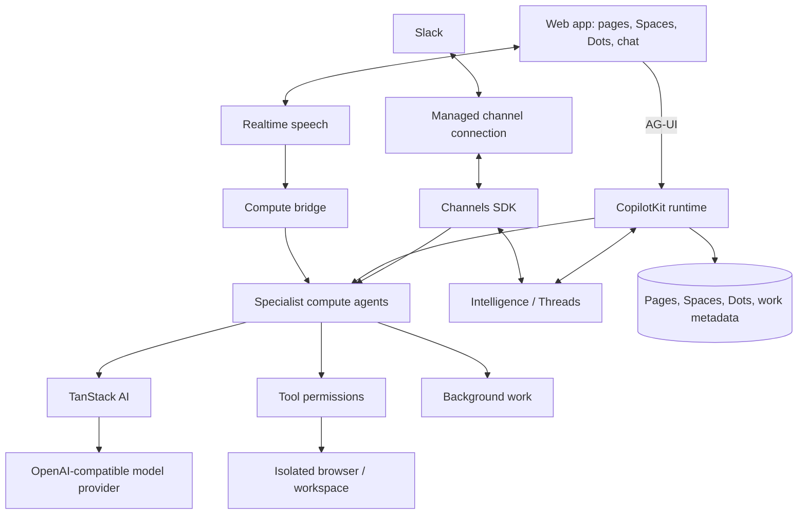

<div align="center">

# OpenDots

### Colegas de IA sempre disponíveis, no chat, em chamadas e no Slack.

**Um modelo de código aberto para agentes de IA persistentes, cada um com seu próprio computador. Disponível na Web e em dispositivos móveis.**

Criado com [CopilotKit](https://github.com/CopilotKit/CopilotKit) e [AG-UI](https://docs.ag-ui.com/introduction). · [Começar](#começar) · [Visão geral](#visão-geral) · [Arquitetura](#arquitetura) · [Recursos](#recursos) · [Como contribuir](CONTRIBUTING.md)

[](https://github.com/CopilotKit/OpenDots/actions/workflows/ci.yml)
[](./LICENSE)


<a href="https://trendshift.io/repositories/275323" target="_blank"></a>

Hospede o OpenDots na sua própria infraestrutura. As conversas exigem o CopilotKit Intelligence: use o serviço hospedado, a [avaliação local com Docker](docs/SETUP.md#local-intelligence-evaluation) ou uma [implantação autogerenciada licenciada](https://docs.copilotkit.ai/intelligence/self-hosting). Clone este modelo e personalize-o como quiser.

[**Desenvolvendo com OpenDots? Converse com a equipe do CopilotKit →**](https://www.copilotkit.ai/talk-to-an-engineer?ref=opendots_readme)

</div>

---

<div align="center">

<table><tr><td>

https://github.com/user-attachments/assets/4c74fe7d-ecdd-42dd-95da-5d34f9b9576e

</td></tr></table>

</div>

_Pergunte → navegue → aprove → salve. A visualização ao vivo do computador e um cartão de revisão aparecem no chat; depois, o rascunho aprovado vira uma página editável no espaço. A imagem foi ampliada para facilitar a leitura; os períodos sem atividade foram removidos e a reprodução foi acelerada._

## Visão geral

O OpenDots é um ponto de partida para criar seu próprio espaço de trabalho com agentes. Clone o projeto, defina seus Dots, conecte seus serviços e adapte a interface e as ferramentas às suas necessidades.

**É um modelo, não um produto hospedado.** Você executa a aplicação e configura a infraestrutura. O modelo ainda está em desenvolvimento inicial; a seção Recursos descreve o que está incluído e diferencia verificações locais de testes com serviços conectados.

### Espaços

Um espaço reúne documentos de trabalho. Os Dots aparecem separadamente na navegação e podem receber acesso a vários espaços nas configurações. Cada Dot tem um destino padrão para páginas salvas; instalações existentes mantêm o acesso original. Navegue pelas páginas em uma biblioteca pesquisável, alterne entre as visualizações em grade e lista e organize documentos em subpáginas. Abra uma página no editor visual com formatação, comandos de barra e desfazer/refazer. Escreva diretamente, salve uma conversa como página ou peça a um especialista para criar e revisar conteúdo.

As páginas ficam no banco de dados local do espaço de trabalho. As conversas usam Threads do CopilotKit, com uma conversa separada para cada página e especialista. Links de páginas conectam a área de documentos ao chat do Dot. A edição manual funciona antes da configuração dos serviços de conversa. O salvamento automático informa o progresso, mantém o rascunho em caso de falha e verifica revisões para impedir que conteúdo antigo substitua versões mais recentes. O modo de edição do Markdown continua disponível.

<div align="center">

<table><tr><td>

https://github.com/user-attachments/assets/d20c3405-4339-49e7-a799-43298728015c

</td></tr></table>

</div>

_Abra um espaço, acesse o resumo de lançamento, pergunte ao Scout sobre a página salva e continue no chat do Dot. Esta gravação usa o chat de página conectado e conteúdo de exemplo._

### Dots especialistas

Dê a cada Dot um nome, papel, instruções e ferramentas permitidas. Um pesquisador pode investigar um tema; um redator pode transformar as descobertas em um rascunho. Revise o trabalho e controle o que cada um pode fazer.

### Computadores dos Dots

Cada Dot pode ter seu próprio computador, usando o supervisor de contêineres e o serviço de computador do [OpenBot](https://github.com/CopilotKit/OpenBot). O perfil do navegador e os arquivos persistem após parar e iniciar o serviço. O painel do computador oferece controle do navegador, transferência do controle para uma pessoa, arquivos, saída do terminal e atividade; as permissões de navegador, arquivos e terminal são definidas por Dot. A aplicação mantém as credenciais do serviço no servidor e gera uma credencial de computador diferente para cada Dot.

Consulte [Configuração do computador](docs/COMPUTERS.md) para criar os serviços fixados e conectá-los à implantação. As ferramentas de computador dependem desses serviços; um modelo sem configuração não executa comandos na sua máquina.

<div align="center">

<table><tr><td>

https://github.com/user-attachments/assets/30b691c3-0f66-4964-9fdb-67d4feab5568

</td></tr></table>

</div>

_Peça ao Scout para abrir um site, resumir o conteúdo, salvar notas e verificar o arquivo. Todas as ações no computador desta demonstração são solicitadas pelo chat; os componentes de ferramentas do CopilotKit exibem o navegador ao vivo, o arquivo salvo e a saída do terminal na conversa._

### Revise antes de salvar

Peça ao Dot para mostrar um rascunho antes de salvá-lo. Um cartão de aprovação humana do CopilotKit pausa a conversa e oferece **Aprovar e salvar** ou **Recusar**. A aprovação cria a página em um espaço autorizado e retorna um link; novas tentativas com o mesmo rascunho recuperam a página salva. Um rascunho alterado precisa de uma nova revisão. O agente continua após sua decisão.

### Conexões

Disponibilize para um Dot ferramentas de qualquer servidor MCP, como e-mail, calendário, GitHub ou serviços próprios. Ferramentas somente leitura são executadas diretamente. Para qualquer outra ferramenta, o chat pausa e mostra um cartão **Aprovar e executar**; a ação só acontece com sua aprovação. Você pode ativar ou desativar cada ferramenta por Dot. Consulte [Conexões](docs/CONNECTIONS.md).

### Texto e chamadas

Uma conversa contínua mantém o avatar e o status do Dot acima das mensagens, com os controles de texto e chamada sempre à mão. Atualizações do trabalho, links de fontes e registros de chamadas aparecem na linha do tempo; um painel lateral mostra resultados ou o computador do agente.

As chamadas combinam fala em tempo real com um agente de execução separado, permitindo que a conversa continue enquanto tarefas mais longas são executadas. Ambos usam o mesmo contexto e as mesmas permissões de ferramentas. A tela da chamada inclui cronômetro, legendas separadas para você e o Dot, controles para silenciar o microfone e o áudio e uma visualização minimizada para continuar no chat. O recurso de voz exige configuração própria do provedor.

<div align="center">

<table><tr><td>

https://github.com/user-attachments/assets/3c06cf71-39ed-4e2b-b846-5463b2722389

</td></tr></table>

</div>

_Conecte, converse, silencie, minimize e volte ao chat. Esta é uma captura sem áudio de uma chamada real, com o tempo de espera removido e a reprodução acelerada._

### Slack

Mencione um Dot por uma conexão gerenciada do Slack usando o Channels SDK e continue na conversa correspondente. A integração segue o [OpenTag](https://github.com/CopilotKit/OpenTag), com uma lista explícita de espaços e usuários autorizados e um especialista selecionado. Consulte [Configuração do Slack](docs/SETUP.md#slack) para conectar sua implantação.

<div align="center">

<table><tr><td>

https://github.com/user-attachments/assets/27d03a6c-a9e0-4c29-8d96-fafe0fbae20f

</td></tr></table>

</div>

Leve seus agentes ao Slack com o [Channels SDK](https://github.com/CopilotKit/channels-sdk). Consulte a [documentação dos Channels gerenciados](https://docs.copilotkit.ai/intelligence/channels) para conectá-los pelo CopilotKit Intelligence.

## Arquitetura

### O AG-UI conecta o agente à interface

[AG-UI](https://docs.ag-ui.com/introduction) transporta mensagens em fluxo, chamadas de ferramentas e o estado do agente entre o backend e os componentes do CopilotKit. A atividade do computador aparece na conversa enquanto o agente trabalha; cartões de aprovação humana pausam uma chamada de ferramenta até sua decisão.

O modelo usa TanStack AI para transmitir respostas do modelo e executar ferramentas no servidor, o SDK React e o runtime do CopilotKit, o Intelligence para Threads persistentes e o Channels SDK para o Slack. Páginas, metadados da aplicação e estado do trabalho em segundo plano são armazenados separadamente do histórico de conversas.



Você configura o projeto Intelligence, o provedor do modelo e a conexão de canais da sua implantação; as chamadas também precisam de um provedor de voz. As credenciais ficam no servidor. Configurações ausentes devem aparecer claramente, e dados de teste devem permanecer visivelmente separados das integrações reais.

[OpenMuse](https://github.com/CopilotKit/OpenMuse) e [OpenBot](https://github.com/CopilotKit/openbot) servem como referências de código para trabalho persistente, computadores dos agentes e controles de execução. O OpenDots pode ser adaptado aos seus fluxos de trabalho e às opções de implantação.

## Começar

Use **Node.js 24** e **npm**:

```sh
git clone https://github.com/CopilotKit/OpenDots.git
cd OpenDots
npm ci
cp .env.example .env
npm run dev
```

Abra **http://127.0.0.1:5173**. Você pode criar espaços, escrever páginas e configurar Dots antes de conectar serviços. Para começar a conversar, conecte um projeto Intelligence e um modelo.

Escolha onde armazenar as conversas antes de conectar. Para avaliar localmente com Docker, siga a [avaliação local do Intelligence](docs/SETUP.md#local-intelligence-evaluation). Para usar o Intelligence hospedado, entre e selecione ou crie um projeto na pasta `OpenDots`:

```sh
npx copilotkit@latest login
npx copilotkit@latest project select
```

`project select` grava uma chave de projeto em `.env` como `CPK_INTELLIGENCE_API_KEY`. Mantenha o `CPK_TELEMETRY_ID` gerado junto com essa chave para que o uso do SDK seja associado à sua conta Intelligence. Depois, adicione `OPENAI_API_KEY` e `OPENAI_MODEL` a `.env` e reinicie `npm run dev`.

Não execute `copilotkit onboard` nesta pasta. O OpenDots já inclui a integração com CopilotKit; o onboarding adicionaria uma segunda integração genérica.

Consulte [Configuração](docs/SETUP.md) para saber mais sobre credenciais, Slack, chamadas, o serviço de navegador e Docker.

## Dados e privacidade

Mensagens, chamadas de ferramentas e eventos de execução são persistidos na implantação configurada do Intelligence. A configuração hospedada os envia à nuvem do CopilotKit; a avaliação local usa o Intelligence na sua máquina. O OpenDots não armazena conversas diretamente no SQLite. O SQLite mantém páginas, metadados do espaço de trabalho e vínculos com Threads em separado.

O provedor de modelo configurado recebe o contexto da conversa, incluindo conteúdo de páginas autorizadas e resultados de ferramentas. Usar o Intelligence local não torna local um modelo remoto: configure separadamente o modelo da aplicação e o modelo de Aprendizado automático. Por padrão, a pesquisa na Web envia consultas e URLs selecionadas ao Parallel; defina `WEB_SEARCH_PROVIDER=disabled` para desativar essas ferramentas. Integrações de voz e mensagens enviam dados aos provedores configurados quando usadas.

A telemetria do SDK CopilotKit coleta metadados de uso separadamente do armazenamento de conversas. O OpenDots também registra etapas limitadas da configuração no navegador e a primeira ativação bem-sucedida do assistente, usando um ID de instalação aleatório; as mesmas opções de desativação interrompem esse rastreamento e removem eventos de configuração pendentes. Consulte [telemetria da configuração no navegador](docs/SETUP-TELEMETRY.md). Os eventos do runtime são identificados como `OpenDots`; veja [rastreamento de cadastro e uso](docs/TELEMETRY.md). Defina `COPILOTKIT_TELEMETRY_DISABLED=true` ou `DO_NOT_TRACK=1` para desativar; consulte a [telemetria do CopilotKit](https://docs.copilotkit.ai/telemetry). Revise a [política de privacidade do CopilotKit](https://www.copilotkit.ai/privacy-policy) e as políticas e configurações de retenção de cada serviço que você configurar. Instalar ou renovar o Intelligence local ainda exige login no CopilotKit e acesso à Internet.

## Recursos

| Área                       | Incluído                                                                                                                                 |
| -------------------------- | --------------------------------------------------------------------------------------------------------------------------------------- |
| Espaços e Dots especialistas | Nomes salvos, instruções de papel e permissões de pesquisa e memória por Dot                                                            |
| Páginas                      | Biblioteca pesquisável, editor visual, comandos de barra, salvamento automático e verificação de revisões                              |
| Conversas                    | Chat com SDK React e Threads, conversas por página e links para fontes                                                                  |
| Slack                        | Declaração gerenciada do Channels SDK com listas de espaços e usuários autorizados                                                       |
| Chamadas                     | Voz por WebRTC, execução delegada, sessões limitadas, encerramento e registros na linha do tempo                                        |
| Trabalho em segundo plano    | Tarefas agendadas no servidor, na conversa original, com controles de pausa e nova tentativa                                           |
| Navegador                    | Serviço separado e somente leitura para páginas públicas, com captura e limites de navegação                                            |
| Computadores dos Dots        | Perfis de navegador, arquivos, terminal, transferência de controle, permissões e registros de ações por Dot via OpenBot               |
| Conexões                     | Servidores MCP por Dot, acesso por ferramenta e aprovação do proprietário para ações que não sejam somente leitura                      |
| Aparência                    | Temas do sistema, claro e escuro; as cores escuras são derivadas durante a compilação dos estilos claros                                |
| Memórias                     | Preferências gerenciadas pelo usuário que os Dots autorizados podem usar                                                                |
| Aprendizado automático       | Contêineres de aprendizado por Dot, roteamento de evidências de conversas e entrega de habilidades publicadas; veja [configuração](docs/SETUP.md#automatic-learning) |
| Implantação                  | Configuração local com Node e contêineres separados para aplicação e navegador                                                         |

As tarefas agendadas são executadas na conversa original. Se um worker parar ou seu prazo expirar durante uma execução, o OpenDots a marca como **Interrompida** e aguarda uma nova tentativa explícita. Revise as páginas e ações no computador e, quando apropriado, use **Tentar novamente após revisão**. Os efeitos da execução podem já ter ocorrido mesmo sem um resultado final.

As verificações locais cobrem configuração, persistência, permissões, tratamento de falhas do SDK e isolamento do navegador. Os testes automatizados usam simulações dos serviços. **Intelligence, respostas do modelo e chat com contexto de página foram verificados ao vivo em 29 de setembro de 2026.** A navegação do computador OpenBot, a criação de arquivos, a verificação pelo terminal e a persistência dos arquivos ao parar e iniciar também foram verificadas localmente. A fala em tempo real, os controles de chamada e a persistência dos registros foram verificados localmente em 30 de setembro de 2026. Slack e delegação de execução por voz ainda precisam de verificação com os serviços conectados. Consulte as [notas das gravações](docs/demos/README.md) para ver os fluxos demonstrados e suas limitações.

O roteamento do Aprendizado automático e a entrega de habilidades estão configurados localmente. Agendamentos na nuvem, contagem de Threads elegíveis e entrega de habilidades publicadas ainda precisam ser verificados com os serviços conectados. As habilidades precisam ser revisadas e publicadas no Intelligence; conversas existentes sem contêiner não são incluídas retroativamente.

Este projeto parte do princípio de um único proprietário. Edição compartilhada, convites, envio de arquivos e incorporações interativas de páginas não estão incluídos. Agendamentos são instruções recorrentes, não um sistema completo de metas ou acionamento por eventos. Dots especialistas têm papéis e conversas separados; conversas em grupo com vários Dots e delegação automática ainda precisam ser desenvolvidas.

### Como ampliar o modelo

- Adicione identidade, associação a espaços e edição compartilhada de páginas para implantações com vários usuários.
- Inclua anexos e conteúdo mais rico nas páginas.
- Adicione gatilhos de eventos e um ciclo persistente de responsabilidades.
- Amplie as ferramentas e os fluxos de aprovação para seus processos.
- Inclua materiais mais ricos, contexto de aplicativos conectados e coordenação entre especialistas.

## Como contribuir

Consulte [Como contribuir](CONTRIBUTING.md) para orientações de desenvolvimento e [Segurança](SECURITY.md) para relatar problemas. As contribuições devem descrever o fluxo de trabalho que habilitam, incluir evidências de verificação e diferenciar integrações reais de simulações.

## Referências

- [AG-UI documentation](https://docs.ag-ui.com/introduction)
- [CopilotKit documentation](https://docs.copilotkit.ai/intelligence/overview)
- [Channels SDK](https://github.com/CopilotKit/channels-sdk)
- [OpenMuse](https://github.com/CopilotKit/OpenMuse)
- [OpenBot](https://github.com/CopilotKit/openbot)
- [OpenTag](https://github.com/CopilotKit/OpenTag) — Channels SDK integration reference

## Licença

[MIT](LICENSE).

## Pesquisa na Web pública

O Parallel é selecionado por padrão para pesquisas reais e conversas com Dots. Faça uma pergunta sobre um tema para localizar e ler até cinco fontes ou informe URLs para extrair o conteúdo diretamente. As fontes são salvas com seus links. Este fluxo de pesquisa não exige um worker de navegador; as ferramentas de computador continuam disponíveis para tarefas interativas.

`WEB_SEARCH_PROVIDER=browser` mantém o leitor de navegador existente, limitado a URLs, e `WEB_SEARCH_PROVIDER=disabled` desativa essas ferramentas de pesquisa. As permissões de pesquisa do espaço e do Dot, além dos controles de pausa e cancelamento, continuam valendo. Pesquisas de exemplo são fictícias e não contatam nenhum provedor.

As consultas, URLs solicitadas, um identificador estável de sessão e o objetivo da pesquisa são enviados para `https://search.parallel.ai/mcp`. Memórias e conversas completas não são encaminhadas automaticamente ao Parallel. Objetivos definidos pelo modelo ainda podem incluir contexto da conversa. O serviço anônimo é gratuito para uso leve, sujeito aos limites do provedor; defina `PARALLEL_API_KEY` no servidor para produção ou limites maiores. Erros do provedor e resultados vazios são informados, sem substituição por evidências inventadas. Consulte a [documentação do Parallel Search MCP](https://docs.parallel.ai/integrations/mcp/search-mcp).
